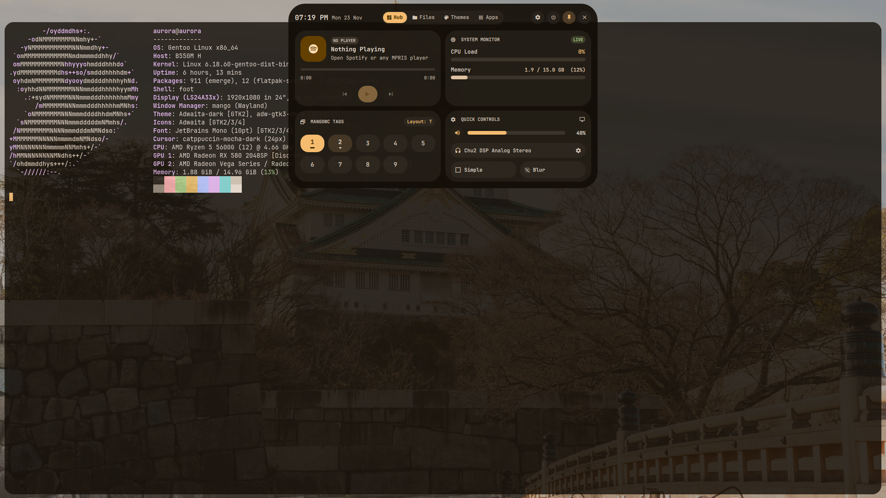
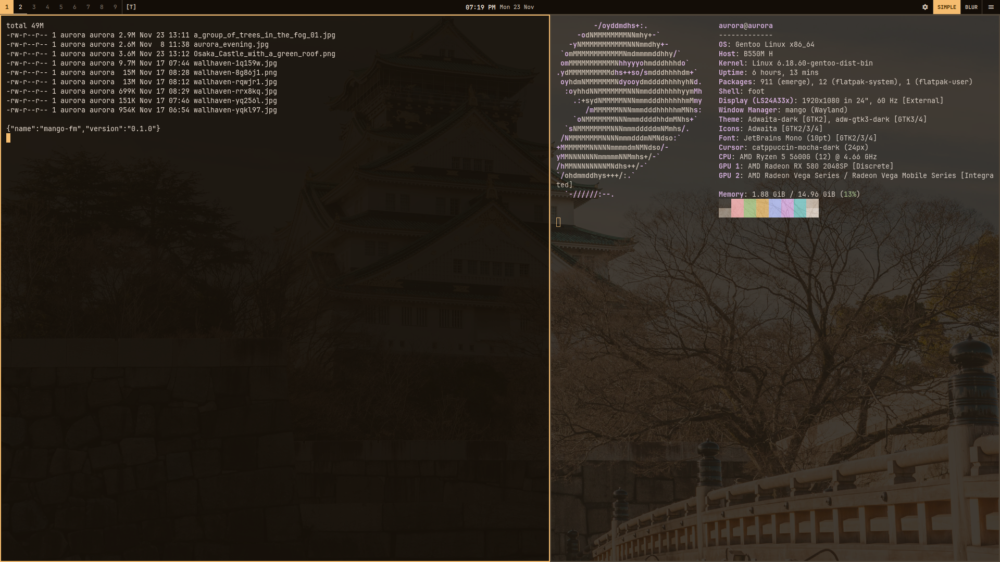
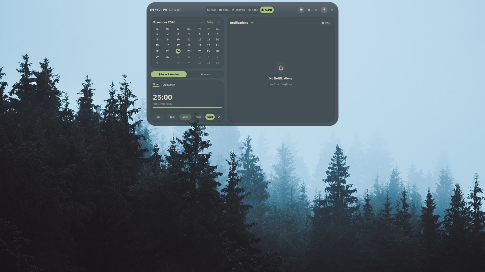
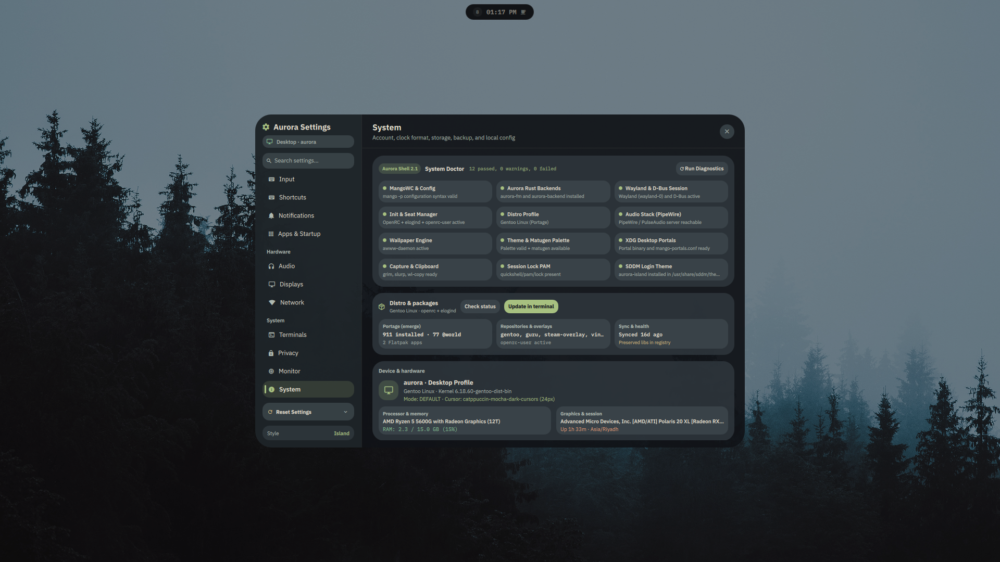
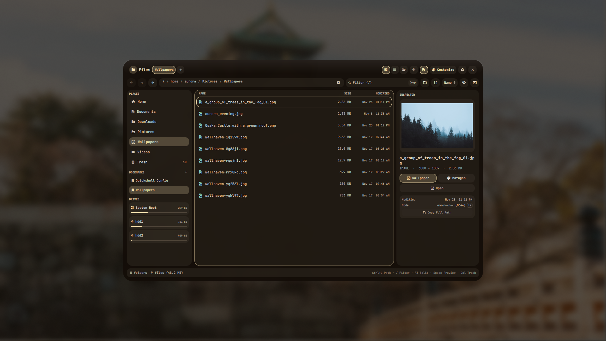
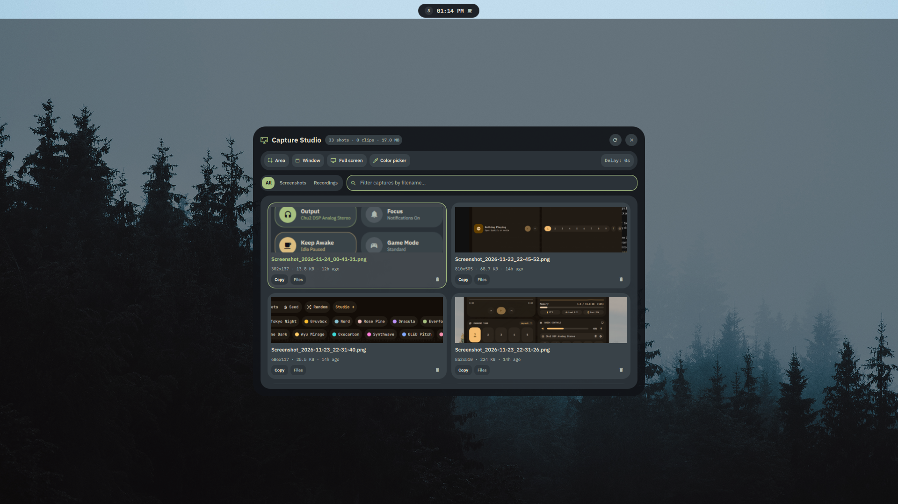

# Aurora Shell 2.1 (MangoWC + Quickshell)

[](#codebase-size)

A reactive, pure-Rust-accelerated Wayland desktop shell built around **MangoWC** (`mangowm` + `scenefx`) and **Quickshell**, hardened for **Arch Linux, Fedora, and Gentoo** (`systemd` and `OpenRC + elogind`), across both **desktop PCs and laptops** with multi-monitor support.

---

## Visual Showcase

| Default Mode (Dynamic Island) | Simple Mode (Square Full-Width Bar) | Blur Mode (Frosted Glass) |
| --- | --- | --- |
|  |  |  |

| Built-in Settings (`Super + S`) | Aurora Rust File Manager (`Super + Shift + E`) | Capture Studio (`Super + Shift + S`) |
| --- | --- | --- |
|  |  |  |

---

## Highlights

- **Pure-Rust System Backend (`rust/aurora-backend` v2.1.0) & Hardware Capabilities (`DeviceCaps`)**: Zero-dependency `std`-only Rust daemon (`#![forbid(unsafe_code)]`) powering cross-distro App Store search/catalog/updates/plans (`store`) and package/service inspection (`distro`, `services`, `service-action`, `power`, `kill-proc`) for **Arch Linux** (`pacman`, `paru`/`yay`, AUR RPC, `checkupdates`), **Fedora** (`rpm`/`dnf5`/`dnf`, RPM Fusion), and **Gentoo** (`Portage`, `@world`, overlays, `preserved-rebuild`) across both **systemd** (`loginctl` / `systemctl`) and **OpenRC + elogind + openrc-user**; plus hardware capability discovery (`probe`), live `/proc` telemetry, multi-battery `/sys/class/power_supply` & `hwmon` aggregation, Wayland clipboard watcher (`wl-paste --watch`), event-driven PiP watcher (`pip watch`), and 12-check **Aurora Doctor** (`doctor`).
- **Dedicated Sequoia Bar & Dynamic Island (`4` Bar UIs x Dedicated Hubs x `7` Visual Modes)**: **Dynamic Island**, **Split Islands**, and **Modular Pill** share a morphing top capsule (`DynamicIsland`) paired with content-fitted **Cupertino**, **Stage**, **Cockpit**, or **Bento** Hubs; **Sequoia Bar** runs as its own stationary macOS-style menu bar (`SequoiaBar`) with dedicated top-right **Control Center** (`Control Center`, `Compact Stack`, `Studio Platter`), Notification Center, and centered **Spotlight** popovers (`SequoiaHub`). Shared `MangoState` PipeWire + single `mmsg` watchers and URL-based `LazyLoader` modals minimize background RAM and subprocess overhead.
- **Native Aurora App Store (`Super + Alt + S`)**: Arch (`pacman` + `paru`/`yay` AUR search & `paru-bin` setup helper), Fedora (`dnf5`/`dnf` + RPM Fusion setup helper), Gentoo Portage, and **Flatpak / Flathub** discovery catalog, live search, batch install queue, installed manager, and pending update checks backed by `aurora-backend store`.
- **Multi-Mode Launcher (`Super + Space` / `Super + V` / `Super + ;`)**: Fuzzy App Launcher plus built-in **Snippets Vault** (`;` prefix or `Super + ;`, `0600`-locked JSON store, pinning, password-manager clipboard exclusion), **Clipboard History Manager** (`cb ` / `Super + V` with pinning & password-manager exclusion), pure recursive-descent **Math, Hex/Binary, Unit Converter (`100f to c`, `2 gib to mb`, `5 km in mi`), and Color Inspector (`#cba6f7`, `rgb(...)`)** (`=`), **Quick Desktop Commands** (`>`), and **Emoji / Nerd Font Glyph Picker** (`:`).
- **Open Window Switcher & Workspace Sessions (`Super + W`) & Power Overlay (`Super + Escape`)**: Fast client switcher across monitors/tags via `mmsg get all-clients` with search, focus, close actions, and **Workspace Sessions** (`workspaces` backend) to save/restore running apps via verified `.desktop`, Flatpak, and `PATH` launchers; plus full-screen 3x2 animated Power Overlay (`Lock`, `Suspend`, `Hibernate`, `Logout`, `Reboot`, `Poweroff`) with keyboard shortcuts (`L/S/H/E/R/P`) and cross-init power routing.
- **Alerts & Agenda Hub (`Super + Shift + N`)**: Unified Notification Center with unread pill badge, interactive **Month Calendar**, **Focus Timer & Lap Stopwatch** docked live in the bar, compact opt-in **Weather Card** (`wttr.in`, 30-min cache), and persistent **Quick Scratchpad**.
- **Animated Wayland Lock Screen & Matching Qt6 SDDM Login Theme (`aurora-island`)**: Smooth entrance/exit zoom & glass-sheen animations, time-of-day greeting, clickable keyboard layout pill, inline MPRIS media controls, auth shake feedback, `WlSessionLock` + user-space PAM verification (`pam/lock`), plus a companion Qt6 SDDM theme (`system/sddm-theme/aurora-island/`) synced automatically on every wallpaper/theme switch.
- **Native Polkit Agent & Idle Power Manager**: Native `PolkitAgent` authentication modal and `ext-idle-notify-v1` auto-lock/auto-suspend daemon (`IdleMonitor`, respecting `keepAwake`, Game Mode, and media inhibitors).
- **Capture Studio (`Super + Shift + S`), Eyedropper & Screen Recording**: Unified Capture Studio (`captures` Rust backend with symlink-rejected PNG/MP4 gallery, PNG `IHDR` dimensions, and XDG Trash), Area (`Super + =`), Fullscreen (`Super + Shift + =`), Focused Window (`Super + Ctrl + =`), and annotated (`--edit`) screenshots, pure-Rust PPM `P6` **Eyedropper Color Picker** (`Super + Alt + C`), and **Screen Recorder** (`Super + Shift + R` via `wf-recorder`) with verified `rec-state` tracking and a live pulsing `REC` pill.
- **Interactive Keybind Cheat Sheet (`Super + /`)**: Searchable category modal displaying live bindings parsed from MangoWC and `local.conf`.
- **Live Matugen, Slideshow & Preset Theming**: Syncs wallpapers (`awww` or `swww` auto-detected) with optional timed **Wallpaper Slideshow**, 16 dark/light presets, 8 one-click vibes, seed accent generator, and JSON custom theme import across Quickshell, MangoWC, GTK 3/4 + `color-scheme` portal preference, Foot, Kitty, Qt6ct, Zed, and SDDM (`flock`-serialized updates). See [`docs/THEMING.md`](docs/THEMING.md).
- **Built-in 19-Page Aurora Settings App (`Super + S`)**: Includes dedicated **Dynamic Island**, **Sequoia Bar**, **App Store**, and streamlined **Shell & Bar** pages alongside the 12-check **Aurora Shell 2.1 System Doctor** + live **Distro & packages** card in System, scope-aware `systemd` / `OpenRC` service controls in Monitor, Appearance, Themes & Colors Studio, Windows & PiP (`Super + P`), Audio, Displays (`wlr-randr`), Network/DNS, Bluetooth, Input & Touchpad, Foot/Kitty Terminals, Notifications/DND, Apps & Startup, live `mango -p`-validated Shortcuts, Privacy / Idle Lock / SDDM sync status, System Backup & Safe Resets.
- **Zero-Dependency Rust File Manager (`rust/aurora-fm`)**: `std`-only pure Rust backend (`Cargo.lock` tracked) with streaming FIPS 180-4 SHA-256 file checksums and symlink-loop-guarded folder size calculation in the Inspector pane, customizable Quickshell UI (`List`, async thumbnail `Grid`, 3-column `Miller`, `Dual-Pane F3`, multi-tab, XDG Trash, mounts, bookmarks, Zip/Tar Slip & flag-injection hardened). See [`docs/FILE_MANAGER.md`](docs/FILE_MANAGER.md).
- **Idempotent Multi-Machine Configs**: Machine-specific overrides stay in `~/.config/mango/local.conf` (`source_optional`) and `~/.config/quickshell/shell-prefs.json`, preserved cleanly across `./install.sh` re-runs.

<details>
<summary><strong>Explore Deep-Dive Documentation (Themes, Vibes, File Manager & Keybinds)</strong></summary>

- **[Theming, 7 Modes, 8 Vibes & 16 Presets](docs/THEMING.md)**: Complete Matugen pipeline, wallpaper engine selection, palette validation, and CLI flags.
- **[Aurora File Manager (`rust/aurora-fm`)](docs/FILE_MANAGER.md)**: Workflow presets (`Finder Columns`, `Minimal Zen`, `Media Gallery`, `Commander`), SHA-256/folder-size inspector, and NDJSON `serve` protocol.
- **[Keybindings & Quickshell IPC](docs/KEYBINDS.md)**: Full MangoWC keyboard/mouse/touchpad table, PiP controls, and `qs ipc call aurora ...` commands.

</details>

---

## Repository Layout

```text
.
├── install.sh                    # Hardened idempotent installer (--dry-run, --no-system, --skip-build, --skip-fonts)
├── uninstall.sh                  # Clean uninstaller (--dry-run, --with-session, --with-sddm, --restore-backup)
├── fonts/                        # Bundled IBM Plex Sans/Mono, JetBrains Mono & Symbols Nerd Font + THIRD_PARTY_LICENSES.md
├── docs/                         # Detailed guides (THEMING.md, FILE_MANAGER.md, KEYBINDS.md)
├── rust/
│   ├── aurora-fm/                # Zero-dependency std-only Rust file manager (installed to ~/.config/quickshell/bin/aurora-fm)
│   └── aurora-backend/           # Zero-dependency std-only Rust backend (telemetry, distro/services, captures, snippets, workspaces, PiP & doctor)
├── config/
│   ├── mango/                    # MangoWC config, mode.conf, theme.conf, autostart.sh
│   ├── quickshell/               # shell.qml, Theme, SystemTelemetry, DeviceCaps, ShellState, components/, files/, settings/, scripts/
│   ├── matugen/                  # Matugen config & templates (Quickshell, GTK 3/4, MangoWC, Foot, Kitty)
│   ├── foot/                     # Foot terminal config + live color palette
│   ├── kitty/                    # Kitty terminal config + live color palette
│   └── xdg-desktop-portal/       # Wayland screencast/screenshot portal configuration
└── system/
    ├── mango-session             # Optional /usr/local/bin/mango-session wrapper (auto dbus-run-session fallback)
    ├── mango.desktop             # Optional /usr/share/wayland-sessions/mango.desktop (Aurora Shell)
    └── sddm-theme/aurora-island/ # Optional Qt6 SDDM theme synced live with active wallpaper & palette (--with-sddm)
```

### Codebase Size

Measured across tracked code and configuration files in `git ls-files` (excluding Markdown docs, license texts, `Cargo.lock`, fonts, and PNG assets):

| Component | Files | Total Lines | Non-Blank Lines |
| --- | ---: | ---: | ---: |
| QML (Quickshell UI & SDDM) | 53 | 45,118 | 40,094 |
| Shell (Bash / POSIX sh) | 20 | 8,277 | 7,539 |
| Rust (`aurora-backend`) | 15 | 6,965 | 6,494 |
| Rust (`aurora-fm`) | 10 | 4,083 | 3,812 |
| Config, CSS Templates & CI | 28 | 1,112 | 1,030 |
| **Total (Code & Config)** | **126** | **65,555** | **58,969** |

---

## Dependencies

### Required vs. Optional Matrix

| Category | Tools / Packages | Purpose |
| --- | --- | --- |
| **Core (Required)** | `mango` (`mangowm` + `scenefx`), `quickshell` (`qs`), `python3`, `qt6-svg`, `qt6-imageformats`, `qt6-5compat` | Compositor, QML bar/island/lock/polkit/settings, helper backend scripts |
| **Build (`aurora-fm` & `aurora-backend`)** | `cargo` + `rustc` (`>= 1.70`) | Compiles both zero-dependency Rust backends (`aurora-fm`, `aurora-backend`) offline |
| **Theming & Wallpapers** | `matugen`, `awww` (or `swww`), `adw-gtk-theme` / `adw-gtk3` | Material You wallpaper extraction, Wayland transitions, GTK/Qt6/Zed/SDDM sync |
| **Audio & Displays** | `pipewire`, `wireplumber`, `pipewire-pulse` (`pactl`), `wlr-randr` | Volume/mic mixer sliders, sink cycler, per-monitor layout, scaling, rotation, VRR |
| **Utilities (Recommended)** | `grim`, `slurp`, `wl-clipboard` (`wl-copy`, `wl-paste`), `libnotify`, `gnome-keyring`, `xdg-desktop-portal{,-wlr,-gtk}`, `foot` or `kitty`, `curl` | Area/window/full screenshots, color picker, clipboard history, weather widget, keyring |
| **Display Manager & Extras (Optional)** | `sddm` (Qt6 greeter), `wf-recorder`, `playerctl`, `brightnessctl`, `wlsunset`, `networkmanager` (`nmcli`), `bluez`, `hyprpicker`, `satty`/`swappy`, `swaylock`, `pavucontrol`, `qt6ct`, `zip`, `unzip` | Matching SDDM login theme (`--with-sddm`), recording, media/OSD, night light, Wi-Fi/BT UI, archives |

<details>
<summary><strong>Distro Package Install Commands (Arch Linux, Fedora & Gentoo)</strong></summary>

#### Arch Linux

```bash
# Official repositories
sudo pacman -S --needed \
  mangowm matugen foot kitty curl \
  wlr-randr grim slurp wl-clipboard brightnessctl libnotify \
  pipewire wireplumber pipewire-pulse playerctl \
  xdg-desktop-portal xdg-desktop-portal-wlr xdg-desktop-portal-gtk \
  gnome-keyring polkit-gnome python adw-gtk-theme rust \
  ttf-jetbrains-mono ttf-nerd-fonts-symbols \
  qt6-svg qt6-imageformats qt6-multimedia qt6-5compat

# AUR packages (Quickshell + awww wallpaper daemon)
yay -S --needed quickshell awww-git

# Optional SDDM Qt6 login screen + desktop extras:
sudo pacman -S --needed sddm qt6-declarative wlsunset wf-recorder hyprpicker satty pavucontrol qt6ct bluez networkmanager swaylock zip unzip
sudo systemctl enable sddm
```

#### Fedora

```bash
sudo dnf copr enable -y dennemann/MangoWC
sudo dnf copr enable -y errornointernet/quickshell
sudo dnf copr enable -y scottames/awww

sudo dnf install -y \
  mangowc quickshell awww \
  foot kitty curl wlr-randr grim slurp wl-clipboard brightnessctl libnotify \
  pipewire pipewire-pulseaudio wireplumber playerctl \
  xdg-desktop-portal xdg-desktop-portal-wlr xdg-desktop-portal-gtk \
  gnome-keyring polkit-gnome python3 adw-gtk3-theme \
  jetbrains-mono-fonts \
  qt6-qtsvg qt6-qtimageformats qt6-qtmultimedia qt6-qt5compat \
  cargo rust

cargo install matugen
# Ensure ~/.cargo/bin is in your PATH

# Optional SDDM Qt6 login screen + desktop extras:
sudo dnf install -y sddm qt6-qtdeclarative wlsunset swappy hyprpicker pavucontrol qt6ct bluez-tools NetworkManager swaylock zip unzip
sudo systemctl enable sddm
```

#### Gentoo (`systemd` or `OpenRC + elogind`)

Enable the **GURU** overlay (`eselect repository enable guru && emaint sync -r guru`) and accept `~amd64` keywords for `gui-libs/scenefx`, `gui-wm/mangowm`, `gui-apps/quickshell`, `x11-misc/matugen`, `gui-apps/awww`, and `gui-apps/wlr-randr`:

```bash
sudo emerge --ask --verbose \
  gui-wm/mangowm gui-apps/quickshell x11-misc/matugen gui-apps/awww \
  gui-apps/wlr-randr gui-apps/foot gui-apps/grim gui-apps/slurp \
  gui-apps/wl-clipboard app-misc/brightnessctl x11-libs/libnotify net-misc/curl \
  media-fonts/jetbrains-mono media-fonts/symbols-nerd-font \
  x11-themes/adw-gtk3 sys-apps/xdg-desktop-portal \
  gui-libs/xdg-desktop-portal-wlr sys-apps/xdg-desktop-portal-gtk \
  gnome-base/gnome-keyring gnome-extra/polkit-gnome \
  media-video/pipewire media-video/wireplumber media-sound/playerctl \
  dev-qt/qtsvg dev-qt/qtimageformats dev-qt/qtmultimedia dev-qt/qt5compat \
  dev-lang/rust

# Optional SDDM Qt6 login screen + full-desktop extras:
# Ensure USE="qt6" (or distro Qt6 profile) is enabled for x11-misc/sddm so sddm-greeter-qt6 is built:
sudo emerge --ask --verbose x11-misc/sddm dev-qt/qtdeclarative gui-apps/wlsunset gui-apps/wf-recorder gui-apps/satty gui-apps/swaylock media-sound/pavucontrol x11-misc/qt6ct app-arch/zip app-arch/unzip
# Enable SDDM:
#   systemd: sudo systemctl enable sddm
#   OpenRC:  set DISPLAYMANAGER="sddm" in /etc/conf.d/display-manager && sudo rc-update add display-manager default
# OpenRC users: ensure sys-auth/elogind is installed & enabled; media-video/pipewire provides gentoo-pipewire-launcher or WirePlumber.
# Native lock screen (LockScreen.qml) uses user-space PAM (config/quickshell/pam/lock + unix_chkpwd) and native PolkitModal uses Quickshell.Services.Polkit without extra root setup.
```

</details>

---

## Installation & Removal

### Install

```bash
git clone https://github.com/AIharthi/mango-quickshell-dots.git
cd mango-quickshell-dots

# Preview everything first (makes zero disk changes)
./install.sh --dry-run

# Standard user install (backs up existing ~/.config entries, preserves local.conf & saved theme/prefs, builds aurora-fm & aurora-backend, installs fonts)
./install.sh

# Optional flags:
#   --with-session   Also install /usr/local/bin/mango-session and /usr/share/wayland-sessions/mango.desktop (requires sudo)
#   --with-sddm      Install matching Qt6 SDDM theme (/usr/share/sddm/themes/aurora-island) & /etc/sddm.conf.d/99-aurora-shell.conf (requires sudo)
#   --no-system      Never touch root/system paths (even with --with-session / --with-sddm)
#   --skip-build     Skip compiling rust/aurora-fm and rust/aurora-backend
#   --skip-fonts     Skip copying bundled fonts (if using distro packages)
#   --no-backup      Skip timestamped backup
```

### Uninstall

```bash
# Preview removals
./uninstall.sh --dry-run

# Remove installed configs and bundled fonts (prompts for confirmation, or pass --yes)
./uninstall.sh --with-session --with-sddm --restore-backup
```

`--restore-backup` restores the most recent `~/.config-backup-aurora-*` (or legacy `~/.config-backup-mango-*`) backup (or pass `--backup <dir>`). Pass `--keep-fonts` to keep bundled fonts.

---

## Quick Start & Keybinds Overview

1. Drop wallpapers into `~/Pictures/Wallpapers/` and open **Theme Switcher (`Super + Shift + T`)**.
2. Press **`Super + S`** to open **Settings** (`19` pages; per-machine overrides go to `~/.config/mango/local.conf`) or **`Super + Alt + S`** for the **App Store**.
3. Press **`Super + Shift + E`** for the Rust-backed **Dynamic File Manager** (or **`Super + Alt + E`** for Dynamic Island Quick Files).

<details>
<summary><strong>Essential Shortcuts (see docs/KEYBINDS.md for all bindings & IPC)</strong></summary>

| Shortcut | Action |
| --- | --- |
| `Super + Return` / `B` / `Z` | Default terminal / browser / editor (`launch-app.sh`) |
| `Super + Space` / `Super + A` | Multi-Mode Launcher (Apps, `; ` Snippets, `=` Calc, `>` Commands, `:` Emoji, `cb ` Clipboard) |
| `Super + ;` | Toggle Snippets Vault (pinning, copy, password-manager exclusion) |
| `Super + V` | Clipboard History Manager (pin, search, copy, clear) |
| `Super + W` | Open Window Switcher & Workspace Sessions across tags and monitors |
| `Super + Shift + S` | Toggle Capture Studio (screenshots gallery, area/window/full capture, color picker, recordings) |
| `Super + Escape` | Full-Screen Power Overlay (`L` Lock, `S` Suspend, `H` Hibernate, `E` Logout, `R` Reboot, `P` Poweroff) |
| `Super + Shift + G` | Toggle Game Mode (Minimal Pill bar, pauses wallpaper slideshow & idle auto-lock) |
| `Super + Shift + N` | Alerts & Agenda Hub (Notifications, Calendar, Timer/Stopwatch, Weather, Scratchpad) |
| `Super + D` | Dynamic Island Hub |
| `Super + /` | Interactive Keybind Cheat Sheet Overlay |
| `Super + Shift + E` / `Super + Alt + E` | File Manager / Dynamic Island Quick Files |
| `Super + S` / `Super + Alt + S` | Settings App / Aurora App Store |
| `Super + Shift + T` | Theme & Wallpaper Switcher |
| `Super + P` / `Shift + P` / `Alt + P` | Toggle Picture-in-Picture / Cycle Corner / Re-Snap |
| `Super + =` / `Shift + =` / `Ctrl + =` | Area / Fullscreen / Focused Window Screenshot |
| `Super + Alt + C` / `Super + Shift + R` | Eyedropper Color Picker (`#RRGGBB`) / Toggle Area Screen Recording |
| `Super + Shift + L` | Animated Quickshell Lock Screen (`WlSessionLock` + PAM, with external fallbacks) |
| `Super + Q` / `Super + 1..9` / `Super + N` | Close window / Switch tag / Cycle layout |
| `Super + R` / `Super + M` | Reload MangoWC / Quit session |

</details>

---

## Troubleshooting

- **OpenRC / Gentoo startup (`dbus`, PipeWire, Power menu)**: Launch via `mango-session` (automatically wraps with `dbus-run-session` when `$DBUS_SESSION_BUS_ADDRESS` is unset). `autostart.sh` launches `gentoo-pipewire-launcher` if present, otherwise starts `pipewire`, `pipewire-pulse`, and `wireplumber` without requiring `systemctl --user`. Ensure `sys-auth/elogind` is running so `loginctl` power/lock actions work.
- **Desktop Portals (`xdg-desktop-portal-wlr`)**: Screen sharing and screenshots require `$XDG_CURRENT_DESKTOP=mango` and a running DBus user session; `config/xdg-desktop-portal/mango-portals.conf` is copied to `~/.config/xdg-desktop-portal/`.
- **`awww` vs `swww` wallpapers**: Both `awww` and `swww` are supported automatically (`awww` takes precedence if both exist). On fresh boot with zero wallpapers or without `matugen`, `apply-theme.sh --init` automatically renders the built-in `catppuccin-mocha` dark palette so the shell never starts unstyled.
- **SDDM theme live sync (`aurora-island`)**: Run `./install.sh --with-sddm` once to install `/usr/share/sddm/themes/aurora-island` (keeping `Main.qml` root-owned while giving your user write access to `theme.conf` and `background.img`). Every wallpaper/preset change in Quickshell updates SDDM automatically, or trigger manually via **Settings -> Privacy** (`Sync SDDM Now`). Preview cleanly with `sddm-greeter-qt6 --test-mode --theme /usr/share/sddm/themes/aurora-island`.
- **Rust backends (`aurora-fm` / `aurora-backend`) missing**: Ensure `cargo` and `rustc` are installed and re-run `./install.sh` (or run `qs ipc call aurora openDoctor` to diagnose missing tools/services).

---

## License

- Dotfiles, QML components, shell scripts, `rust/aurora-fm`, and `rust/aurora-backend`: [MIT License](LICENSE)
- Bundled fonts (`fonts/IBMPlexSans/`, `fonts/IBMPlexMono/`, `fonts/JetBrainsMono/` SIL OFL 1.1 & `fonts/SymbolsNerdFont/` MIT): see [`fonts/THIRD_PARTY_LICENSES.md`](fonts/THIRD_PARTY_LICENSES.md)
